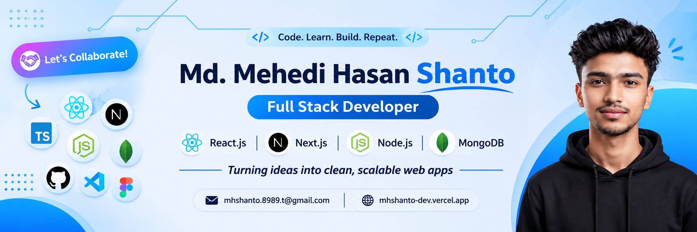

 
<!-- ===================================================== -->
<!-- HERO BANNER -->
<!-- ===================================================== -->

  

<h1 align="center">
  
</h1>

  <strong>Full Stack Developer | MERN Stack</strong>
   
  Building modern, scalable, responsive, and user-focused web applications.

  

---

## 👨‍💻 ABOUT ME

- 👋 Hi, I'm [**Md. Mehedi Hasan Shanto**](https://github.com/mhshanto-dev), a passionate **Full Stack Developer (MERN Stack)**.
- 💻 Working with **JavaScript, TypeScript, React.js, Next.js, Node.js, Express.js, and MongoDB**.
- ⚙️ Building real-world applications with RESTful APIs, secure authentication, and responsive user interfaces.
- 🧠 A consistent learner with a growth mindset, strong work ethic, and a commitment to continuous improvement.
- 🚀 Always ready to take on challenges, solve problems, and turn ideas into practical solutions.
- 🤖 Exploring AI-assisted development to build smarter and more efficient applications.
- 🌐 Explore my [**Portfolio**](https://mhshanto-dev.vercel.app/) and check out my [**Resume**](https://drive.google.com/file/d/1qxln957GjQbbeK4tIsxboed5nNit6uAK/view?usp=sharing).
- 📝 I regularly share my thoughts and learning experiences through articles on [**LinkedIn**](https://www.linkedin.com/in/mh-shanto/).
- 📫 Feel free to reach me at [**mhshanto.8989.t@gmail.com**](mailto:mhshanto.8989.t@gmail.com).
- 💼 Open to **Junior Full Stack Developer, React Developer, Frontend Developer, and Software Engineer** opportunities.

---

## 🌐 FOLLOW ME ON SOCIALS

  
  
  

---

## 🛠️ TECHNOLOGY STACK

**💻 Languages**  

**🎨 CSS Frameworks & Libraries**  

**⚛️ JavaScript Frameworks & Libraries**  

**🗄️ Database & ORM**  

**🔐 Authentication & Security**  

**🎭 UI Libraries & Animation**  

**🚀 Deployment Platforms**  

**🎨 Design & Graphics**  

**🔧 Tools & Technologies**  

---

## 📚 CURRENTLY LEARNING — NEXT LEVEL

  Continuously expanding my full-stack development skills and exploring modern software engineering practices.

<table width="100%">
<tr>
<td width="50%" valign="top">

### 📖 Learning Now

- 🔷 Advanced TypeScript
- ▲ Next.js & Full-Stack Development
- 🐘 PostgreSQL
- 🔶 Drizzle ORM
- ⚙️ Software Engineering Fundamentals

</td>
<td width="50%" valign="top">

### 🚀 Exploring Next-Level

- 🤖 Large Language Models (LLM)
- 🔍 Retrieval-Augmented Generation (RAG)
- 🦜 LangChain
- 🧠 AI Integration & AI-Powered SaaS Development

</td>
</tr>
</table>

  <i>Learn continuously. Build consistently. Improve every day. 🚀</i>

------

## 🚀 PINNED PROJECTS

### 🚀 Joventra — Job Board & Talent Acquisition Platform

A full-stack recruitment platform designed to simplify the hiring process by connecting job seekers and employers in one place.

- **Problem:** Job seekers and employers need a centralized platform to manage job opportunities and recruitment activities.
- **Target Users:** Job seekers, recruiters and employers.
- **Solution:** Built a recruitment platform with dedicated workflows for job discovery, applications and talent management.
- **Key Features:** Job posting and management, candidate applications, role-based dashboards, JWT authentication, Google OAuth 2.0, Stripe Checkout and payment webhooks.
- **Technologies:** React, TypeScript, Tailwind CSS, Node.js, Express.js, MongoDB.
- **My Contribution:** Developed the frontend and backend, implemented authentication and role-based access, integrated payment workflows and connected REST APIs.
- **Result & Learning:** Built a full-stack recruitment application and gained practical experience with authentication, authorization, payment integration and end-to-end application workflows.

**Links:** [Live Demo](https://joventra-beige.vercel.app/) | [Backend](https://joventra-server.vercel.app/)

### 🏥 MediCare Connect — Healthcare Appointment Platform

A healthcare platform that helps patients connect with doctors and manage appointments through an online system.

- **Problem:** Managing doctor appointments and healthcare services can be difficult without a centralized digital platform.
- **Target Users:** Patients, doctors and healthcare administrators.
- **Solution:** Developed a platform for appointment booking, doctor management and online healthcare services.
- **Key Features:** Patient, doctor and admin dashboards, Google authentication, appointment management, online payments and digital prescriptions.
- **Technologies:** Next.js, MongoDB, Better Auth, Stripe, JWT.
- **My Contribution:** Built the application frontend and backend, implemented authentication, role-based workflows and integrated appointment payment functionality.
- **Result & Learning:** Developed a healthcare application and strengthened my understanding of Next.js, authentication, role-based systems and payment integration.

**Links:** [Live Demo](https://frontend-orpin-eight-50.vercel.app/) | [Client Source Code](https://github.com/mhshanto-dev/MedicareConnect) | [Server Source Code](https://github.com/mhshanto-dev/MedicareConnect-Server)

### 📚 StudyNook — Study Room Booking Platform

A responsive platform that allows users to discover and book study rooms through a simple online experience.

- **Problem:** Finding and booking suitable study spaces can be inconvenient without an organized booking system.
- **Target Users:** Students and people looking for dedicated study spaces.
- **Solution:** Created a platform where users can explore available study rooms and manage their bookings.
- **Key Features:** Study room management, room booking, Google sign-in and responsive user interface.
- **Technologies:** Next.js, React, HeroUI, Node.js, Express.js, MongoDB, Better Auth.
- **My Contribution:** Developed the client and server applications, worked on authentication, room management and booking workflows.
- **Result & Learning:** Built a full-stack booking application and improved my practical skills in Next.js, API integration, authentication and database operations.

**Links:** [Live Demo](https://studynook-client-bice.vercel.app/) | [Client Source Code](https://github.com/mhshanto-dev/assignment-9) | [Server Source Code](https://github.com/mhshanto-dev/assingment-9-server)

### 🤖 ResumePilot — AI Resume & Portfolio Builder

An AI-powered application that helps users extract information from resumes, generate professional summaries and create shareable portfolios.

- **Problem:** Creating a professional resume and presenting skills effectively can be time-consuming.
- **Target Users:** Job seekers, students and professionals.
- **Solution:** Built an AI-powered application that uses uploaded resume content to generate useful career-related information and portfolios.
- **Key Features:** PDF content extraction, AI-generated resume summaries, skill extraction and shareable portfolios.
- **Technologies:** Next.js, React, TypeScript, MongoDB, Clerk Authentication, Google Gemini AI.
- **My Contribution:** Developed the application interface, integrated authentication and connected AI-powered resume processing features.
- **Result & Learning:** Built an AI-powered resume application and gained practical experience with Gemini AI integration, PDF processing and AI-assisted application development.

**Links:** [Live Demo](https://resumepilot-eight.vercel.app/) | [Source Code](https://github.com/mhshanto-dev/AI-Resume-Builder-complete)
------

## 📊 GITHUB STATISTICS & ANALYSIS

### 🐍 GitHub Contributions

  

### 📈 GitHub Statistics

  
  

### 🔥 GitHub Streak

  

---

## 📫 LET'S CONNECT

I'm always interested in learning, collaborating, building meaningful projects, and exploring new opportunities in software development.

If you have an interesting project, collaboration opportunity, or developer opening, feel free to connect!

- 📧 **Email:** [mhshanto.8989.t@gmail.com](mailto:mhshanto.8989.t@gmail.com)
- 🌐 **Portfolio:** [mhshanto-dev.vercel.app](https://mhshanto-dev.vercel.app/)
- 💼 **LinkedIn:** [linkedin.com/in/mh-shanto](https://www.linkedin.com/in/mh-shanto)
- 🐙 **GitHub:** [github.com/mhshanto-dev](https://github.com/mhshanto-dev)

---

## 📜 CERTIFICATIONS

Explore my certificates and completed courses:

  

---

  <strong>💻 Code. Learn. Build. Improve. Repeat. 🚀</strong>

  <i>Me vs Me ✦ Consistent Learning ✦ Continuous Growth</i>

